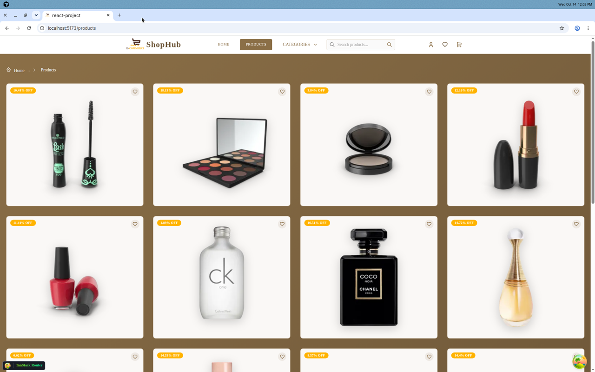
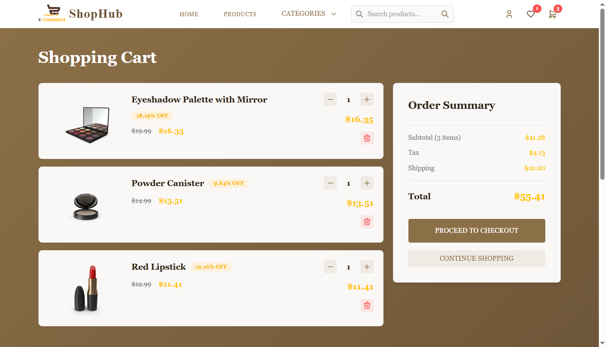

# ShopHub

متجر إلكتروني حديث مبني بـ React + TypeScript، يوفّر تجربة تسوق كاملة: تصفح المنتجات، الخصومات، المفضلة، السلة، وإتمام الطلب.

**Live demo:** [https://react-project-jade-gamma-92.vercel.app](https://react-project-jade-gamma-92.vercel.app/)

<p align="center">
  
</p>

### فيديو توضيحي للمشروع وهو شغال

[▶ مشاهدة فيديو الديمو (ShopHub وهو شغال)](./docs/demo/shophub-demo.mp4)

<p align="center">
  <a href="./docs/demo/shophub-demo.mp4">
    
  </a>
</p>

| الصفحة الرئيسية | المنتجات | تفاصيل المنتج |
| --- | --- | --- |
|   
) |  |

---

## المشكلة التي يحلها والفئة المستهدفة

### المشكلة
كثير من تجارب التسوق الإلكترونية تكون إما بطيئة، أو غير منظمة، أو تفقد بيانات السلة عند تحديث الصفحة. ShopHub يعالج ذلك عبر واجهة سريعة وواضحة، مع حفظ السلة والمفضلة محليًا، وتنظيم المنتجات بالفئات والخصومات والعروض المحدودة.

### الفئة المستهدفة
- **المتعلمون والمطورون** الذين يريدون مشروع E-commerce واقعي بهندسة نظيفة (Repository / Adapters / Modules).
- **أصحاب المتاجر الصغيرة / الناشئة** كأساس واجهة أمامية لمتجر إلكتروني.
- **المستخدم النهائي** الذي يحتاج تصفح سريع، مقارنة أسعار وخصومات، وإضافة للسلة ثم checkout بدون تعقيد.

---

## أهم الفيتشرز التي طورتها

- **واجهة رئيسية غنية**: Hero banner، New Arrivals، Best Sellers، وFlash Sale مع عدّاد تنازلي.
- **كتالوج منتجات**: قائمة منسّقة، تصفح حسب الفئة، صفحات ترقيم (pagination)، وصفحة تفاصيل مع التقييمات والمراجعات.
- **سلة تسوق ذكية**: إضافة/حذف/تحديث الكمية، حساب الخصم والضريبة والشحن، مع حفظ الحالة في `localStorage`.
- **المفضلة (Favorites)**: حفظ المنتجات المفضلة محليًا وعرض عددها في الهيدر.
- **Checkout**: نموذج بيانات الشحن وإنشاء طلب مع تفريغ السلة بعد الإتمام.
- **تصميم متجاوب وعلامة تجارية موحّدة**: ثيم ShopHub (بني/ذهبي) مع Mantine وFramer Motion.

---

## التحديات التي حليتها

1. **فصل طبقة الـ API عن الـ UI**  
   بنيت المشروع بنمط Modules + Repository + Adapters، بحيث تحويل بيانات DummyJSON (`title` → `name`, حساب `discountedPrice`, إلخ) يحدث في الـ adapter دون تلويث المكوّنات.

2. **مزامنة حالة السلة والمفضلة مع التخزين المحلي**  
   استخدمت `localStorage` مع React Query / Context حتى تبقى السلة والمفضلة بعد إعادة تحميل الصفحة، مع تحديث فوري لعدادات الهيدر.

3. **تجربة تصفح سلسة مع بيانات خارجية**  
   التعامل مع تحميل المنتجات، الفلترة حسب الفئة، والـ pagination، وإدارة حالات التحميل/الأخطاء عبر TanStack Query.

4. **Routing حديث وآمن نوعيًا**  
   بناء المسارات بـ TanStack Router مع صفحات Home / Products / Product Details / Cart / Checkout، مع دعم search params للفئات.

5. **واجهة متسقة وجذابة**  
   توحيد الثيم والألوان والحركة عبر Mantine + Framer Motion، بدل واجهة مبعثرة بصريًا.

---

## التقنيات المستخدمة

| الطبقة | الأدوات |
| --- | --- |
| UI | React 19, TypeScript, Mantine, Framer Motion, Tabler Icons |
| Data | TanStack Query, DummyJSON API |
| Routing | TanStack Router |
| State محلي | localStorage (Cart / Favorites / Checkout) |
| Build | Vite, pnpm, Vercel |

---

## التشغيل المحلي

```bash
pnpm install
pnpm dev
```

ثم افتح [http://localhost:5173](http://localhost:5173)

```bash
pnpm build    # بناء للإنتاج
pnpm preview  # معاينة البناء
```

---

## هيكل المشروع (مختصر)

```text
src/
  components/     # Layout, Home, Hero, Sliders
  modules/
    products/     # كيانات، hooks، repository، adapters، views
    categories/
    cart/
    favorites/
    checkout/
  routes/         # TanStack Router pages
docs/demo/        # صور وفيديو توضيحي للمشروع
```
